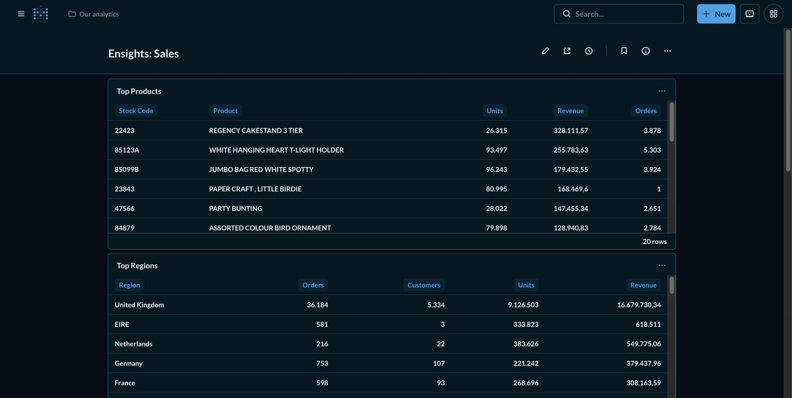
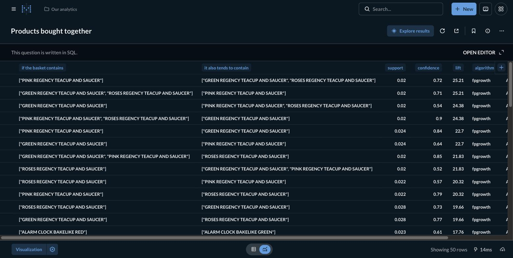
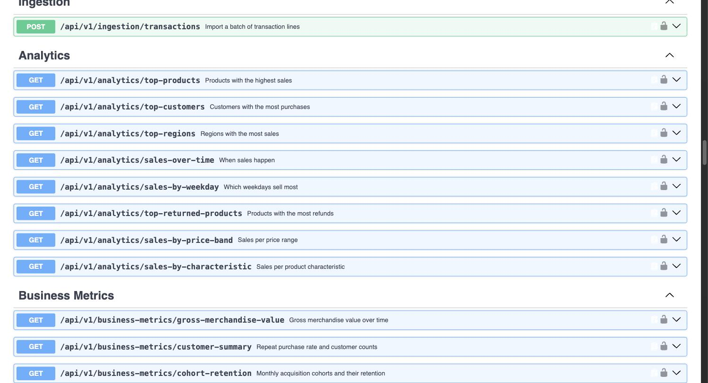

# Ensights

Master's thesis project, National and Kapodistrian University of Athens:
**"Extraction of Intelligent Analytics from E-Commerce Data"**.

Submitted to the interdepartmental postgraduate programme in Management and
Economics of Telecommunication Networks and Information Systems, run jointly
by the Department of Informatics and Telecommunications and the Department of
Economics. That pairing is why the work is judged on both sides: the data
mining and the machine learning on one, and the economics the results are
supposed to inform on the other.

A FastAPI backend that turns raw e-commerce transactions into business
intelligence: frequent itemsets, customer segmentation, revenue forecasting,
growth accounting, and unit economics, exposed through a REST API and a set
of Metabase dashboards. The manuscript itself lives in [`thesis/`](thesis/),
built from the same code and data this repository runs.

## What this actually does, in plain words

An online shop already records every sale it makes. That record is usually
just a long list of lines: this invoice, this product, this many units, at
this price, on this date, to this customer, in this country. On its own the
list answers nothing, because nobody can read a million lines.

Ensights reads that list and answers the questions the shop actually asks.
It works in three steps.

**1. Bring the data in.** The shop sends its sales, either by posting them to
the API, by letting the system read its database, or by exporting a file.
Whatever the original format, every line is converted into one common shape,
so the analysis never has to know which shop it came from. That common shape
is written down as a contract in
[`documents/ingestion-contract.md`](documents/ingestion-contract.md).

**2. Store it as facts.** The lines become customers, products, regions,
orders, order lines and returns in a PostgreSQL database. Nothing is
pre-summarised and refunds are kept separate from sales, so no figure is
silently baked in and later impossible to take apart.

**3. Answer questions about it.** Some answers are simple counting, like which
products sold most. Others need data mining or statistics, like which products
tend to be bought together, which customers behave alike, or what revenue
might look like next month.

There are then three ways to read the answers, and they are for three
different audiences:

| Surface | Who it is for | What it gives |
| --- | --- | --- |
| **REST API** (`/api/v1/...`) | Another program, or anyone clicking through Swagger | Every answer as JSON, including the ones that come from models |
| **Metabase dashboards** | A shop owner who does not write code | Tables and charts over the stored facts, refreshed by reloading |
| **Jupyter notebooks** (`notebooks/`) | The thesis itself | The experiments and the figures printed in the manuscript |

They are not three copies of the logic. Metabase reads the same database with
a read only account, and a card and its matching endpoint are required to
return the same number. The notebooks call the same code the API calls.

One deliberate limit is worth saying out loud, because it is the honest part
of the work. The dataset contains no cost of goods and no marketing spend, so
the system cannot measure whether the shop is profitable. The profitability
endpoints therefore return a scenario built on assumptions that are stated in
the response itself, never a measurement, and every response carries that
disclaimer with it.

## Setup & run

### 1. Prerequisites

[uv](https://docs.astral.sh/uv/getting-started/installation/) and
[Docker](https://docs.docker.com/engine/install/), both running.

One thing to know before starting: the containers, volumes and network are
named after the project, `ensights-postgresql`, `ensights-redis` and so on, so
another project generated from the same template no longer shares this one's
database. That was a real hazard before the naming was scoped per project,
because the names were global and a second stack silently attached to the
first one's data.

Host ports are still shared, though. This stack publishes 5432, 6379, 5672 and
3000, so a second project on its defaults collides there and the second one to
start fails to bind. That failure is loud and harmless, unlike the silent one
it replaced. Give the other project its own `POSTGRESQL_PORT`, `REDIS_PORT`,
`RABBITMQ_PORT` and `METABASE_PORT` in its `.env` and both run side by side.

### 2. Install and provision

```bash
./scripts/setup.sh
```

Installs dependencies, generates every secret into `.env`, creates the TLS
certificates, starts Postgres and Redis, applies migrations, and creates the
superuser plus the `metabase_readonly` role. First time only.

### 3. Start everything

```bash
./scripts/demo.sh
```

Starts Postgres, Redis, RabbitMQ and Metabase, applies migrations, seeds a
synthetic demo dataset if the database is empty, mines the market baskets,
waits for Metabase to actually answer, prints the URLs and the demo login,
then runs the API server in the foreground. `Ctrl+C` stops the API server, the
containers keep running. Re-running it is safe and will not duplicate data.

The seed is synthetic, roughly 2800 orders over 24 months. It exists so every
endpoint and every dashboard card has something to show on a first run. Its
figures are invented, see step 7 for the real dataset.

### 4. Get a token

Every analytical endpoint needs one. The easiest route is
[http://localhost:8000/try](http://localhost:8000/try), which has an
**Authorize** button. From the shell:

```bash
TOKEN=$(curl -s -X POST http://localhost:8000/api/v1/auth/login \
  --data-urlencode "username=admin@ensights.com" \
  --data-urlencode "password=$(grep -m1 ^FIRST_SUPERUSER_PASSWORD= .env | cut -d= -f2-)" \
  | python3 -c "import json,sys; print(json.load(sys.stdin)['access_token'])")

curl -H "Authorization: Bearer $TOKEN" \
  "http://localhost:8000/api/v1/business-metrics/customer-summary"
```

The login endpoint takes form fields, not JSON, and `username` is the email.

### 5. Check that it all works

In a second terminal, while `demo.sh` holds the first:

```bash
./scripts/verify.sh
```

It logs in, calls every analytical endpoint and fails if any returns an error
**or** an empty payload, checks that Metabase is serving, and runs all twelve
dashboard cards as `metabase_readonly` against the live database. Anything
broken is named with the command to investigate it.

### 6. Set up the Metabase dashboards

```bash
uv run --env-file .env python scripts/metabase_cards.py
```

Metabase starts empty. This creates the admin account, using the same
`FIRST_SUPERUSER_EMAIL` and `FIRST_SUPERUSER_PASSWORD` you logged into the API
with, connects the database as the read-only `metabase_readonly` user that
`setup.sh` provisioned, builds the twelve cards from `metabase/queries/`,
arranges them on three dashboards, and sets the number separators so a figure
reads `379.437,96` the way the manuscript writes it.

Then open [http://localhost:3000](http://localhost:3000) and sign in. Running
the script again after editing a query updates that card in place.

[`metabase/README.md`](metabase/README.md) explains what each card shows, which
dashboard it belongs to, the three places a card deliberately differs from its
endpoint, and how to do the same by hand if you would rather.

### 7. Load the real dataset, to reproduce the thesis

The demo seed is synthetic and its numbers match nothing in the manuscript.
Download the [Online Retail II
dataset](https://archive.ics.uci.edu/dataset/502/online+retail+ii), export both
sheets to CSV, then import each one:

```bash
uv run --env-file .env python -c "
import asyncio
from app.core import SYSTEM_TENANT_ID
from app.core.tenant import set_current_tenant_id
from app.database import async_session_factory
from app.ingestion.online_retail import OnlineRetailCSVAdapter
from app.services.ingestion_service import IngestionService

async def main():
    set_current_tenant_id(SYSTEM_TENANT_ID)
    async with async_session_factory() as session:
        print(await IngestionService(session).import_from(
            OnlineRetailCSVAdapter('online_retail_II.csv')))

asyncio.run(main())
"
```

Then re-mine the baskets over the new data, at the support threshold the
manuscript reports:

```bash
uv run --env-file .env python -c "
import asyncio
from app.core import SYSTEM_TENANT_ID
from app.core.tenant import set_current_tenant_id
from app.database import async_session_factory
from app.services.market_basket_service import MarketBasketService

async def main():
    set_current_tenant_id(SYSTEM_TENANT_ID)
    async with async_session_factory() as session:
        _, result = await MarketBasketService(session).run(
            algorithm='fpgrowth', minimum_support=0.02, minimum_confidence=0.3)
    print(result.basket_count, len(result.itemsets), len(result.rules))

asyncio.run(main())
"
```

That prints `36269 385 134`, the figures in chapter 5. Do not use
`scripts/seed_demo.py` for this step: it mines at 1% support, chosen so the
small synthetic catalogue still produces rules, and on the real dataset that
yields 1.185 rules whose strongest lift is 47,8 rather than the 134 rules and
lift 25,2 the manuscript reports. Both are correct for their threshold, but
only one matches the text.

Skip the synthetic seed entirely by importing before the first `demo.sh`, since
it only seeds when the database has no orders.

## Adding data

The platform isn't tied to the Online Retail II dataset used in the thesis.
Three ways to bring your own:

1. **Push a batch**, `POST /api/v1/ingestion/transactions` with up to 5000
   lines. No code needed.
2. **Point at a database**, describe which columns hold which field, a
   background task streams rows in from any database SQLAlchemy can reach.
   No adapter to write, but it runs as a Celery task, not an HTTP call.
3. **Write a file adapter**, for a layout that doesn't fit the above, the
   way `app/ingestion/online_retail.py` does for the reference dataset.

Full field-by-field rules are in
[`documents/ingestion-contract.md`](documents/ingestion-contract.md).

## Where to watch the results

- **Swagger UI**, [http://localhost:8000/try](http://localhost:8000/try):
  every endpoint below, with "Try it out".
- **Metabase**, URL printed by `demo.sh`: 12 SQL cards over the same facts the
  API reads, added by hand into 3 suggested dashboards (setup notes in
  [`metabase/README.md`](metabase/README.md)).
- **`./scripts/verify.sh`**: proves both of the above are actually answering
  with data.

| Endpoint prefix | What it answers |
| --- | --- |
| `/api/v1/analytics` | Sales by product, region, time, price band. |
| `/api/v1/business-metrics` | GMV, repeat-purchase rate, cohort retention, RFM. |
| `/api/v1/segmentation` | Customer clustering (region/time, then RFM). |
| `/api/v1/market-basket` | Frequent itemset mining and association rules. |
| `/api/v1/forecasting` | Revenue forecasts vs. a naive baseline. |
| `/api/v1/growth-accounting` | Revenue decomposed into new/retained/churned flows. |
| `/api/v1/profitability` | LTV, CAC, and unit-economics sensitivity grids. |

The reasoning and sourcing behind these are documented in
[`documents/methodology/`](documents/methodology/).

## The answers that only the API can give

Sales, returns and mined itemsets are stored in the database, so a Metabase
card can show them. Forecasts and segments are not stored: they are produced
by models that run when the request arrives, so they are read from the API.
`metabase/README.md` explains the split. All four examples below are real
responses over the full Online Retail II dataset, abridged.

**Revenue forecast, compared against a naive baseline.** The comparison is the
point. A model that cannot beat "next month looks like this month" has proved
nothing, so the baseline and the skill score are always reported, including
when the skill score is negative:

```bash
curl -H "Authorization: Bearer $TOKEN" \
  "http://localhost:8000/api/v1/forecasting/revenue?horizon=3"
```

```json
{
  "method": "exponential_smoothing",
  "horizon": 3,
  "history_length": 25,
  "forecast": [587222.83, 502905.56, 671261.41],
  "metrics": {"mean_absolute_error": 419623.67, "mean_absolute_percentage_error": 51.12},
  "baseline_metrics": {"mean_absolute_error": 346864.32},
  "skill_score": -0.21
}
```

The negative score here is the default run over every month. The dataset stops
on 9 December 2011, so its final month holds nine days and reads as a collapse
rather than a truncation. Chapter 7 excludes that period, and the same model
then scores `+0.1421` against the baseline. The endpoint reports the honest
number for whatever window it is given.

**Nested customer segmentation.** Countries are clustered first, then each
cluster is split again on purchasing behaviour. The silhouette score for every
candidate number of clusters is returned, so the choice of `chosen_k` can be
checked rather than trusted:

```json
{"chosen_k": 2, "silhouette": 0.8793,
 "scores": {"2": 0.8793, "3": 0.7206, "4": 0.6691, "5": 0.6347, "6": 0.6264},
 "clusters": [{"label": "1", "level": 1, "size": 42, "members": ["Australia", "Austria", "..."]}]}
```

**Growth accounting.** Each month's revenue is decomposed into where it came
from, so a flat total that hides equal churn and acquisition cannot look
healthy:

```json
{"period": "2010-01-01T00:00:00", "revenue": 524504.67,
 "new": 156527.47, "retained": 265475.35, "expansion": 102501.85,
 "contraction": 130293.16, "churned": 270131.82,
 "gross_retention_rate": 0.399, "quick_ratio": 0.647}
```

**Unit economics.** Note the disclaimer travelling with the numbers. The
dataset has no costs and no marketing spend, so this is a scenario over stated
assumptions and the response says so itself:

```json
{"average_customer_revenue": 2895.0, "lifetime_value": 1447.5,
 "assumptions": {"gross_margin": 0.5, "customer_acquisition_cost": 0.0},
 "disclaimer": "Scenario output, not a measurement. The source data contains no cost of goods and no marketing spend, so these figures follow from the stated assumptions and hold only insofar as those assumptions do."}
```

## Reproducing the thesis figures

The manuscript's numbers come from this code and the public dataset, so they
can be checked. This needs the real dataset, step 7 above, not the synthetic
demo seed. Importing Online Retail II and calling
`/api/v1/business-metrics/customer-summary` returns 4234 repeat customers
against 1618 one time customers, a repeat purchase rate of 72.4%, 6.25 orders
per customer and an average order value of 493.63, which are the figures
quoted in chapter 7.

## Screenshots

All three are the running system over the complete Online Retail II dataset,
both sheets, 39,516 orders spanning 2009 to 2011.

**Metabase**, the Sales dashboard. Three boards split the twelve cards, as `metabase/README.md` describes:



**Frequent itemsets**, mined with FP-Growth and read back as association
rules. Lift is the interesting column, since support and confidence alone
would promote a rule whose right hand side is merely a popular product:



**Swagger UI** at `/try`. The analytics endpoints, with "Try it out" on each:



## Periodic Tasks

- **RedBeat**: Redis-backed Celery beat scheduler, safe to run more than one beat instance

The schedule lives in `app/celery_app.py` under `beat_schedule`. Beat reads it
at startup and enqueues each entry when it comes due, a worker then runs it.
Beat only schedules, it never executes, so both processes have to be running.

This project uses **RedBeat**. The schedule is stored in Redis and beat takes a
Redis lock on startup, so several beat instances can run at once and only the
lock holder fires each tick. That is what makes a rolling deploy or a
`replicas: 2` beat deployment safe.

Beat must be started with the scheduler flag. Without `-S
redbeat.RedBeatScheduler` you get Celery's default scheduler, RedBeat's
startup hook then looks for a `lock_key` that scheduler does not have, and the
resulting `AttributeError` is swallowed, so you silently lose the lock while
believing you have it:

```bash
celery -A app.celery_app beat -S redbeat.RedBeatScheduler -l info
```

Entries can be added or changed at runtime through `redbeat.RedBeatSchedulerEntry`
without restarting beat.

## Exporting the thesis PDF

The manuscript is built with `dimscthesis`, the class the Department of
Informatics and Telecommunications publishes, vendored unchanged at
`thesis/dimscthesis.cls`. It sets Arial, which no TeX distribution ships: a
local build picks it up from the system, a container build stages it from
`/System/Library/Fonts/Supplemental`, and CI installs it from Debian contrib.

```bash
./scripts/export-thesis.sh          # needs local XeLaTeX + bibtex
./scripts/export-thesis.sh --docker # or build inside a TeX Live container
```

Output: `documents/<author>-thesis.pdf`, the file to hand over.

## License

MIT License, see [LICENSE](LICENSE) file.
